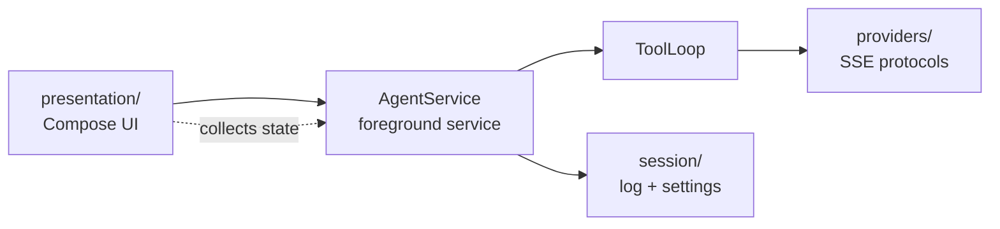

# AGENTS.md

WearAgent — an AI chat client for Wear OS round-screen watches, talking to OpenAI-compatible
(Completions / Responses) and Anthropic endpoints. Kotlin, Jetpack Compose for Wear OS.

## Build and verify

JDK 17+ (CI uses 21); the module targets Java 11 bytecode. Android SDK 36.1.

```bash
./gradlew :app:assembleDebug          # gradlew.bat on Windows
./gradlew :app:testDebugUnitTest      # JVM tests, no device needed
./gradlew :app:connectedDebugAndroidTest   # Compose UI tests, needs an emulator/device
```

CI (`.github/workflows/ci.yml`) only builds debug and release APKs — **it runs no tests**. A green
CI run does not mean the tests pass; run them locally.

Instrumented tests need a booted emulator. A Wear OS API 34+ image works. The suite hangs on
Espresso 3.5.0 (`InputManager.getInstance` was removed in API 34); the version catalog pins 3.7.0 —
do not lower it. If a Wear emulator's clock drifts behind the host, TLS validation fails
(`Chain validation failed`) because the endpoint certificate looks not-yet-issued; fix the emulator
clock rather than the app.

## Architecture



- `agent/` — protocol and turn logic. `ChatProvider` defines the interface; `providers/` holds one
  SSE implementation per protocol, all extending `SseChatClient` (HTTP, cancellation, SSE framing,
  model-list retry). `ToolLoop` runs one turn across multiple tool rounds. `Transcript` is the
  provider-agnostic history model; each provider converts it to its own wire format. User turns may
  carry `ImageAttachment`s (base64 + media type): each provider encodes them into its own inline
  format, and `supportedImages()` is the shared filter that drops a media type no protocol accepts
  rather than failing the whole request.
- `agent/tools/` — model-callable tools, mirroring the provider shape: an `interface Tool`, an
  `abstract class HttpTool`, and a `defaultTools()` registry.
  - `Tool` is the contract the loop depends on: `definition`, optional `setting`/`enabledBy` for the
    Settings toggle, `execute`, `cancel`. `ToolLoop` holds `List<Tool>`, offers only enabled tools,
    and dispatches a call by `definition.name` — it never names a concrete tool.
  - `HttpTool` owns the shared machinery: sticky cancellation that aborts in-flight calls, and the
    failure rule — a thrown error becomes a model-facing error result, while cancellation stays an
    `InterruptedIOException` the loop acts on. A subclass supplies `definition` and `invoke(call)`,
    and uses `executeHttp`/`boundedBuilder` so cancellation and timeout bounds apply uniformly.
  - Protocols must not know concrete tools. Anthropic needs historical schemas to replay a tool
    block after tools are disabled, so the caller passes `knownTools` (all shipped definitions)
    through `stream`/`requestBody` rather than the provider importing a tool.
  - Implementations live in `tools/web/` (`WebSearchTool`, `FetchTool`); a tool with its own
    dependencies can take a subpackage of its own.
  - Adding a tool = implement `Tool` (usually via `HttpTool`), add it to `defaultTools()`, and give
    it a `ToolSetting` if it needs a toggle. `ToolsPage` renders those toggles from the registry, so
    the settings UI needs no edit.
  - Tools that reach arbitrary hosts are opt-in and default off. `FetchTool` sends whatever the
    model asks (any method/headers/body) to any http(s) URL, so it never follows redirects and caps
    the response it buffers; keep that shape for any new network tool.
- `session/` — `SettingsStore` (DataStore), `SessionLog` (append-only JSONL, one file per session),
  and the pure view models the UI renders: `RequestInfo` (`expandHistory` — the one provider-history
  rule, shared by `AgentService` and the request view — plus `describeRequest`) and
  `ContextBreakdown` (the context bar's slice estimate). A killed process replays the file; nothing
  lives only in memory.
  - `SettingsStore` owns every persisted preference as an `AgentSettings` field. Add a preference by
    adding the field, its DataStore key, and a `set…` method; the whole app reads it through one
    `settings` flow. A preference whose absence is meaningful (a list the user can empty) must
    distinguish "unset" from "empty" — `systemPrompts` does this by checking whether the key is
    present, so deleting every prompt does not resurrect a default.
  - Message images are stored as files, not inline: `ImageStore` writes them content-addressed
    under `files/images/` and the JSONL line keeps a `{name}` reference, so a line stays small and
    a conversation loads without megabytes of base64. `SessionLog` prunes unreferenced files after
    every write and on session delete, so removing a session reclaims its images. `ImageCodec` is
    the seam: `StoredImages` writes references, `InlineImages` keeps the old self-contained form
    and is what `TranscriptCodec` defaults to, so a record written before the store still loads.
- `presentation/` — Wear Compose UI. `chat/` (screen, pull-up drawer, bubbles, action sheets),
  `markdown/` (renderer), `settings/` (page registry + pages).
  - `chat/` splits by layer: the screen (`ChatScreen`, `MainActivity`, `ChatPager`), the message
    surface (`MessageList` — the curved list — `MessageBubble`, `MessageBlocks` — tool/reasoning/usage
    blocks — `MessageSheets`), the drawer (`PullSheet`, `SheetChrome`), and two subpackages:
    `chat/pages/` (`ContextPage`, `TrajectoryPage` — the pager's info pages) and `chat/images/`
    (`ImagePreview` — shared decode plus the full-screen preview — `ImageStrip`, `AttachmentStrip`,
    `PickedImages`, `GallerySaver`). Splitting a piece out of `chat/` means widening `private fun` to
    `internal fun`; keep that the only API widening.
  - `chat/ImagePreview.kt` holds what every image surface shares: `decodeImage`, the
    off-thread `rememberDecodedImages`, the 64dp/two-up `THUMBNAIL` constants, and the
    full-screen `ImagePreviewDialog` (double-tap zoom, pinch, pan, long-press menu built
    from the same `ActionPageButton` as the message sheet, back to dismiss).
  - The chat is a three-page `HorizontalPager` (`ChatPager`): the conversation, the context usage,
    and the request trajectory. A long-press sheet's "view request" pages to the trajectory, which
    renders `session/describeRequest` — one row per user/assistant/tool item with a role chip and a
    one-line preview, expanding to the full payload and result, and long-pressing to jump back to
    the message it came from. The context page is a stacked bar over `session/contextBreakdown`.
  - Round-screen support is the `roundFit` setting: it narrows page/bubble widths and adds bezel
    padding. Any new full-screen surface should honor it rather than hard-coding a width.
  - `settings/` is a self-registering page tree: each page file declares a top-level
    `settingsPage(...)` `val`, and the `SettingsPageFiles` manifest in `SettingsRegistry` touches
    one symbol per file so class init registers it. Top-level pages (`parent == null`) are the
    settings home; children are reachable only through their category. A new page inside an
    existing file needs no manifest change; a new file needs one line. Pages are grouped by
    category into subpackages (`chat/`, `model/`, `display/`, `system/`), each holding its
    category page plus its children.
  - `SettingsWidgets` holds the shared row components (`SettingRow`, `SettingToggle`, `SettingSwitch`,
    `SettingField`, `SettingTextArea`, `TransformedItem`). A row that must scale at the bezel needs
    `transformedHeight` *and* `graphicsLayer { applyContainerTransformation() }` — `TransformedItem`
    does both, while `Scaled` alone only reserves height and will not scale.

Keep `agent/` free of Android UI dependencies. `AgentService.kt` is the only file there that imports
`android.*` (it is a `Service`); everything else is plain Kotlin so it stays JVM-testable.

## Rendering pipeline

`presentation/markdown/` is split by dependency direction — `MarkdownText` (render) →
`MarkdownParse` (CommonMark → blocks) → `MarkdownMath` (LaTeX extraction); `LatexImage` (raster) is
shared by the render layer. Shared internals are `internal`, not `public`.

Two invariants that cost real bugs to find:

- **Math is extracted before markdown parsing.** LaTeX escapes (`\\`, `\{`, `\_`) must survive the
  CommonMark pass, so formulas are replaced with opaque markers first and re-inserted afterwards.
  Fenced and inline code are copied verbatim so a literal `$` in code is not treated as a formula.
- **jlatexmath keeps process-wide mutable statics.** `MacroInfo.Commands` is global, so a
  `\newcommand` in one formula would otherwise redefine commands for every formula rendered
  afterwards, across messages and sessions. `renderFormula` snapshots and restores that table
  around each parse. Built-in aliases (`\dfrac`, `\operatorname`, matrix environments) register
  *lazily on first parse*, so `ensureCommandTableInitialized()` forces those classes to load before
  the snapshot — without it the restore deletes the built-ins.

Inline formulas render in TeX text style, display formulas in display style; the stock
`JLatexMathDrawable` hard-codes display style, which inflates inline operators to block height, so
rasterization goes through `TeXIconBuilder` + `AndroidGraphics2D` directly.

## Code style

Formatting is `kotlin.code.style=official`: 4-space indent, trailing commas on wrapped
argument/parameter lists. There is no configured formatter — do not reformat files you did not
otherwise touch. Long lines exist (some exceed 100 columns); follow the surrounding file.

### File size and structure

**Keep files short. One file is one concern.** No file should grow past roughly 300 lines; when a
file mixes distinct responsibilities, split it before adding to it. `MessageBubble.kt` (434 lines)
is the current worst case and a standing candidate for another split.

- Split by **dependency direction or concern, not by line count**. `markdown/` is the worked
  example: `MarkdownText` (render) → `MarkdownParse` (CommonMark → blocks) → `MarkdownMath` (LaTeX
  extraction), with `LatexImage` (raster) shared by the render layer. A 667-line file became four
  files that each have one reason to change.
- Separate protocols/providers, one implementation per file (`providers/`). Separate UI pieces that
  are independently testable or reused (`chat/`, `markdown/`).
- Prefer **adding a file over growing an existing one**. If a new feature does not obviously belong
  to an existing concern, it gets its own file.
- Split shared internals as `internal`, not `public`; do not widen the module's API to enable a
  split.

### Comments

**Write as few comments as possible, and only where they carry weight.** Assume the reader knows
Kotlin and Compose; do not narrate what the code plainly says, and do not add a comment just to
have one.

- Comment a **non-obvious decision, invariant, or constraint** — something the code cannot show by
  itself: a workaround for a library bug, a deliberate ordering, a security boundary, a reason a
  seemingly simpler approach is wrong.
- Do **not** comment straightforward control flow, obvious naming, or restate a signature. No
  section-divider banners, no changelog notes in code, no commented-out code.
- Prefer no comment over a redundant one. If a comment and the code disagree, delete the comment.
- Existing files run about 4–8% comment lines; treat that as the ceiling, not a target. Match the
  surrounding file when editing it.

## Project conventions
- **User-facing strings live in resources**, both `res/values/` (Chinese, the default) and
  `res/values-en/`. Never hard-code user-visible text.
- **Settings are declared, not wired by hand.** Add a page in
  `presentation/settings/pages/` with `settingsPage(...)` and reference it in the
  `SettingsPageFiles` manifest in `SettingsRegistry.kt`; the registry handles navigation and
  ordering. Adding a child page to an existing category file needs no manifest change.
- **Persisted settings are additive.** `SettingsStore` encodes endpoint profiles as JSON and reads
  missing keys with defaults, so an added field stays backward compatible with existing installs.
  The JSONL session format is likewise read defensively; do not break existing session files.

### Commit messages

**Keep them short: a one-line subject, plus a few bullets only when the change is not obvious.**
The subject names the change; the body shows the key points, not a narrative.

- Subject: `type(scope): summary` — `feat` / `fix` / `refactor` / `docs` / `test` / `chore`.
  Imperative, lowercase, no trailing period.
- Body: at most a handful of bullets covering what changed and, for a fix, the **root cause** — not
  every touched file. Skip the body entirely when the subject is self-explanatory.
- No verification logs, no file inventories, no restating the diff. A reader should get the point in
  a few seconds.

## Security notes

`utils/InsecureTls.kt` backs the per-endpoint "Ignore SSL certificate validation" setting. It
accepts any certificate and hostname, so it also removes interception protection. It must stay an
explicit, per-endpoint, default-off choice, and never be applied to the fixed web-search endpoint
(`tools/WebSearchTool.kt`) or shared with a verifying client.

## Verifying changes

Behavioural changes need a run, not just a compile. Prefer the narrowest proof that exercises the
changed path:

- Protocol / settings / session logic — `:app:testDebugUnitTest` (MockWebServer stands in for the
  endpoint; `okhttp-tls` builds a self-signed HTTPS server for TLS cases).
- Rendering and UI — `:app:connectedDebugAndroidTest` against a booted emulator.
- Anything user-visible — drive the installed debug APK on an emulator and look at it.

Watch for state that survives across renders or turns (macro tables, caches, `sent` lists) and for
values that can look equal while the UI should have changed; these are where bugs have hidden.
