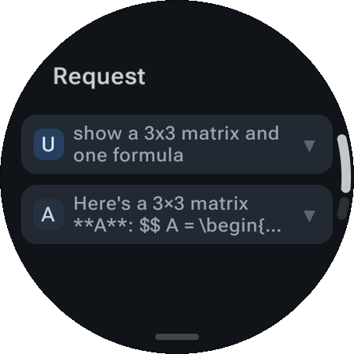
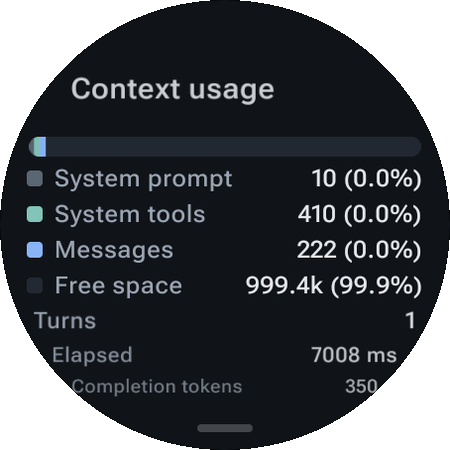
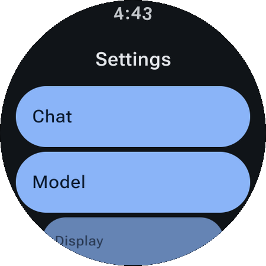

# WearAgent

[English](README.md) | **中文**

<p align="center">
  
  
  
  
</p>

一个为 Wear OS 圆屏手表打造的轻量 AI 聊天客户端。在手表上直接对话任意 OpenAI 兼容接口（或 Anthropic），支持流式回复、思维链展示、Markdown/LaTeX 渲染 —— 全部在手表的约束内完成：小屏幕、低内存。

## 功能

### 聊天

- **流式聊天** —— OpenAI Completions / Responses 和 Anthropic Messages 的 SSE 流式输出
- **思维链** —— 推理模型（如 DeepSeek）的思考过程流入回复气泡内的可折叠块：思考中自动展开，正文开始自动收起，随消息持久化保存
- **图片输入** —— 用 app 自带的圆屏选择器选图（系统选择器的方形网格会被圆屏裁角），因此需要「图片和视频」权限。发送前统一降采样为 1024px JPEG，再按各协议的内联格式编码（Completions `image_url`、Responses `input_image`、Anthropic base64 `image` 块）。附件在气泡内以单行横向滚动的缩略图显示，并计入上下文用量条。点击可全屏预览：双击缩放（带动画）、捏合自由缩放、拖动平移、长按保存到相册。图片以内容寻址存为 `files/images/` 下的文件，会话行只存引用——删除会话时，无人引用的图片会被清理
- **Markdown + LaTeX** —— Commonmark（GFM 表格/删除线）；`$..$`、`$$..$$`、`\(..\)`、`\[..\]` 四种公式定界符，行内或块级均用 JLaTeXMath 渲染；转义美元符与行内代码不被误判
- **Token 用量** —— 每条回复底部显示 `↓ 输出, ↑ 输入 (缓存) · t/s`
- **消息操作** —— 长按气泡弹出全屏操作页：复制、选择文本、重新生成（用户消息也支持）、修改、删除

### 工具

模型可自行调用工具；每个工具默认关闭，在设置中开启并附隐私说明。

- **网页搜索** —— Parallel 公共搜索服务，无需额外密钥；结果随回复保存在本地
- **抓取网页** —— 对任意网址发起自定义方法/请求头/正文的 HTTP 请求；不跟随重定向，响应体有大小上限
- **实时工具块** —— 每次调用在回复气泡内显示为可折叠块（进行中 → 已完成/失败），摘要由工具自己给出，可展开查看结果

### 页面

左右滑动聊天页，逐步看到「发出去的东西」：

- **请求信息** —— 按模型实际看到的顺序，逐行列出用户/助手/工具条目，调用与结果配对，带 `U`/`A`/`T` 角色标签。展开行看完整请求与结果；长按可跳回该条对应的消息
- **上下文用量** —— 模型上下文窗口的叠加进度条：系统提示词、系统工具、消息、空闲空间，各带 token 数与占比；下方是回合数、耗时与输出 tokens

### 手表界面

- **圆屏原生** —— 官方 Wear Compose Material 3，列表项贴边时按弧线缩放
- **上拉抽屉** —— 把手常驻离底 9dp；上拉出输入框，再拉出设置
- **弯曲/平铺列表** —— 可切换，另有圆屏适配宽度与公式宽度适配选项

### 平台

- **多接口配置** —— 多个 endpoint 档案，各自独立 API 类型、密钥与模型；模型列表从供应商获取
- **系统提示词** —— 总开关 + 可新建/编辑/删除的命名提示词列表，按协议放在正确位置发送
- **上下文窗口** —— 每个接口独立设置，从常见预设中选择，作为上下文条的基准
- **会话日志** —— 每行一个 JSON 对象（JSONL）的追加式格式；进程被杀后按文件重放，内存不独占任何数据
- **前台服务** —— 每回合在前台服务中运行，通知栏带停止按钮；停止时保留已生成的部分内容
- **国际化** —— 中文（默认）与英文

## 构建

需要 JDK 17+、Android SDK 36。

```bash
./gradlew :app:assembleDebug
adb install -r app/build/outputs/apk/debug/app-debug.apk
```

Windows 使用 `gradlew.bat` 代替 `./gradlew`。

Huawei Watch 的包安装器会阻止 ADB 安装。仅在这类手表上临时停用安装器，安装 APK，然后重新启用。即使安装失败，也必须恢复安装器。

```bash
adb shell pm disable-user --user 0 com.android.packageinstaller
adb install -r app/build/outputs/apk/debug/app-debug.apk
adb shell pm enable --user 0 com.android.packageinstaller
```

### 发布签名

`assembleRelease` 在配置了发布密钥时使用正式签名，否则回退到 debug 密钥（保证本地构建可用）。
本地配置写在 `keystore.properties`（已 gitignore，可复制 `keystore.properties.example`）：

```properties
storeFile=keystore/wearagent.jks
storePassword=...
keyAlias=wearagent
keyPassword=...
```

CI 通过同名环境变量传入这些值（`SIGNING_STORE_FILE`、`SIGNING_STORE_PASSWORD`、
`SIGNING_KEY_ALIAS`、`SIGNING_KEY_PASSWORD`），由仓库 secrets（`KEYSTORE_BASE64`、
`KEYSTORE_PASSWORD`、`KEY_ALIAS`、`KEY_PASSWORD`）填充。发布流程在缺少密钥时会直接失败，
并校验产物不是 debug 签名。

请务必保管好密钥库：丢失后将无法用同一包名更新已安装的正式版本。

## 配置

1. 打开应用 → 上拉抽屉 → 设置
2. **模型 → 接口 → 新接口**
3. 填接口地址（如 `https://api.example.com`）和密钥
4. 获取模型列表 → 选择模型（或手动输入）
5. **模型 → 上下文窗口** → 选择该模型的上下文窗口
6. 可选：**模型 → 工具** 开启网页搜索/抓取，**模型 → 系统提示词** 设置提示词
7. 上拉 → 输入 → 发送

## 许可证

本程序为自由软件：你可依据自由软件基金会发布的 GNU Affero 通用公共许可证（第 3 版或任意后续版本）重新分发或修改它。详见 [LICENSE](LICENSE)。
